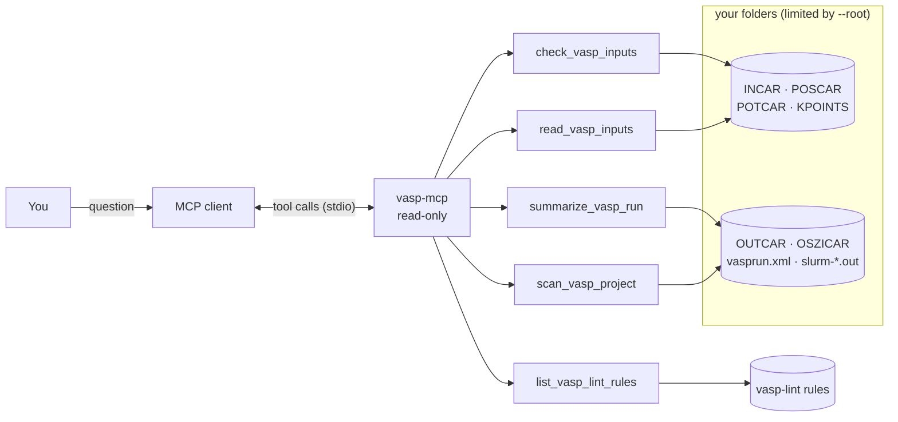

# vasp-mcp

[](https://github.com/NabKh/vasp-mcp/actions/workflows/tests.yml)
[](LICENSE)


An [MCP](https://modelcontextprotocol.io) server that gives an MCP client read-only access to your VASP calculations:
check the inputs **before** you submit, and find out what actually happened **after** the job ends.

Ask your assistant things like:

- *"Check the inputs in `~/calcs/NiO/hse` before I submit."*
- *"Did the relaxations under `~/calcs/slabs` converge? Which ones need a restart?"*
- *"What is the band gap of this run, per spin channel?"*
- *"Why did this job crash?"*

The assistant gets numbers parsed from OUTCAR, vasprun.xml and the job's standard output, instead of
guessing from a pasted log.



## Tools

| Tool | What it returns |
|---|---|
| `check_vasp_inputs` | Mistakes in INCAR, POSCAR, POTCAR, KPOINTS (30 checks from [vasp-lint](https://github.com/NabKh/vasp-lint)), each with the INCAR line and the VASP wiki page it is based on |
| `summarize_vasp_run` | Finished or not; electronic steps that hit NELM; whether the relaxation reached EDIFFG; final energies; largest force on a free atom (selective dynamics respected); pressure; Fermi level; magnetisation; MD temperatures and DFT vs machine-learned steps; band gap per spin; VASP warnings; known errors in the job output (ZBRENT, BRMIX, EDDDAV, wall time, out of memory, ...); a plain list of problems |
| `scan_vasp_project` | Every calculation folder below a path, with status (finished / incomplete / not run), last energy and relaxation convergence. Reads only the end of each OUTCAR, so large projects scan in seconds |
| `read_vasp_inputs` | Parsed INCAR tags, structure, POTCAR dataset names and cutoffs, k-mesh |
| `list_vasp_lint_rules` | All input checks with their wiki links |

Example `summarize_vasp_run` result for a relaxation that went wrong (abridged):

```json
{
  "status": "finished with problems",
  "kind": "relaxation",
  "problems": [
    "Electronic loop reached NELM = 5 in ionic step(s) 1: that SCF is not converged to EDIFF and its energy and forces are unreliable.",
    "Relaxation stopped after 2 ionic steps (NSW = 50) without reaching EDIFFG = -0.01. Restart from CONTCAR.",
    "Largest force on a free atom is 0.200 eV/A, above |EDIFFG| = 0.01 eV/A.",
    "Error messages in standard output: line search in the ionic relaxation failed."
  ],
  "energy": {"energy_sigma_to_0": -10.1, "free_energy_TOTEN": -10.101, "unit": "eV"},
  "max_force_eV_per_A": 0.2,
  "ionic_converged": false,
  "stdout_errors": [{"file": "slurm-1234.out", "message": "ZBRENT: fatal", "count": 1}]
}
```

### Band gaps

The gap is taken from the eigenvalues and occupations of the last step in vasprun.xml, for each spin
channel and overall. When states at the Fermi level are only partly occupied (occupation between 0.01
and 0.99) the channel is reported as metallic, instead of the spurious few-meV "gap" that a simple
occupied/empty split gives for a half-metal. For an insulator the result agrees with pymatgen's
`Vasprun.eigenvalue_band_properties`.

## Install

```bash
pip install git+https://github.com/NabKh/vasp-mcp
```

or run it without installing, with [uv](https://docs.astral.sh/uv/):

```bash
uvx --from git+https://github.com/NabKh/vasp-mcp vasp-mcp --help
```

## Connect it to your assistant

Most MCP clients take a JSON entry like this in their configuration file:

```json
{
  "mcpServers": {
    "vasp": {
      "command": "vasp-mcp",
      "args": ["--root", "/Users/you/calculations"]
    }
  }
}
```

`--root` limits the server to that folder (repeat it for several). Without it, any folder the client
names can be read. On a cluster, run the client there, or mount the cluster's scratch with sshfs.

## Privacy

Every tool only reads files; nothing is written, run or sent anywhere by the server. POTCAR contents are
never returned, only the dataset names, valences and cutoffs. Keep in mind that whatever the tools return
is passed to the assistant you connected, and from there to its model provider.

## Development

```bash
pip install -e ".[dev]"
pytest
ruff check .
```

## License

MIT
